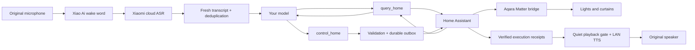

# Xiaomi Speaker → Jarvis

[简体中文](README.zh-CN.md) · English

**Reuse a Xiaomi speaker's microphone and speaker with your own model and Home Assistant, without opening the enclosure.**

This repository packages an agent Skill, a detailed field guide, and a runnable Python reference implementation. It follows the entire journey from finding a speaker on the LAN to controlling real lights and curtains through native model tools.

The tested path keeps **Xiao Ai wake-word detection and Xiaomi cloud speech recognition**. Your model handles interpretation and device selection. Home Assistant executes the actions, and the original speaker reads the verified results.

> This is a cloud transcript bridge, not replacement firmware. It does not provide root access, raw microphone PCM, an offline wake word, or complete removal of Xiaomi's own assistant logic.

## What a successful interaction looks like

```text
You:      小爱同学 → 把客厅的灯关掉
Xiaomi:   Recognizes the utterance and exposes a fresh transcript.
Model:    Calls query_home, then control_home for the living-room lights.
Jarvis:   Validates and persists the batch, sends HA commands, checks states.
Speaker:  Reads the actual results, then returns to muted standby.
```

You do not need to say “Jarvis” again after waking the speaker. The model can resolve a room and device category without requiring exact HA entity names. “Do not turn off the lights” and “first suggest which curtains to close” must not become device writes.



The reference implementation permits one read tool round and one terminal control batch. The executor speaks its real receipts directly; the model does not run a second repair loop after a write.

## Start with the Skill

Clone the repository and copy the complete skill folder into your agent's skill directory. This example uses Codex:

```bash
git clone https://github.com/WdBlink/xiaomi-speaker-jarvis-skill.git
cd xiaomi-speaker-jarvis-skill
mkdir -p "$HOME/.codex/skills"
test ! -e "$HOME/.codex/skills/xiaomi-speaker-jarvis" && \
  test ! -L "$HOME/.codex/skills/xiaomi-speaker-jarvis" && \
  cp -R skills/xiaomi-speaker-jarvis "$HOME/.codex/skills/xiaomi-speaker-jarvis"
```

If a skill already exists at the destination, inspect it before updating; do not overwrite it with these commands. In another agent host, use that host's skill installation mechanism and preserve the whole folder, including references and assets.

Example request:

> Use `$xiaomi-speaker-jarvis` to inspect my existing Xiaomi speaker and Home Assistant setup. Continue from the current state, connect my model without disassembly, and verify real device control. Reuse completed pairing and keep credentials private.

The Skill entry point and detailed operational guide are written in Chinese. Both repository READMEs describe the scope, setup, and limitations in their respective languages; commands, schemas, and the reference implementation are usable independently.

## Read the steps you need

| Stage | Guide | Details preserved from the implementation |
| --- | --- | --- |
| 1. Discover and authenticate | [LAN and account access](skills/xiaomi-speaker-jarvis/references/01-discovery-and-auth.md) | Identity evidence, miIO token versus micoapi session, QR visibility and expiry, STS fallback, why SSH is not root |
| 2. Connect the home | [Home Assistant and Matter](skills/xiaomi-speaker-jarvis/references/02-home-assistant-matter.md) | Raspberry Pi, IPv6, bridge commissioning, existing HomeKit pairing, Docker image recovery, room mapping |
| 3. Connect voice | [Transcripts and audio](skills/xiaomi-speaker-jarvis/references/03-voice-and-audio.md) | Fresh-record filtering, original TTS, pause semantics, idle miIO timestamps, the working mute path |
| 4. Give the model tools | [Native tools and execution](skills/xiaomi-speaker-jarvis/references/04-agent-tools-and-execution.md) | Semantic device selection, current time and state, durable writes, cancellation, truthful feedback |
| 5. Operate and verify | [Deployment and acceptance](skills/xiaomi-speaker-jarvis/references/05-operations-and-validation.md) | Layered evidence, real actions, restart without replay, audio restoration |
| 6. Diagnose failures | [Troubleshooting](skills/xiaomi-speaker-jarvis/references/06-troubleshooting.md) | Symptoms, checks, failed approaches, and unresolved cases |
| 7. Run the bundled code | [Reference runtime setup](skills/xiaomi-speaker-jarvis/references/07-reference-runtime.md) | Dependencies, exact config fields, login, startup, and read-only probes |

## Reference runtime

Prerequisites: Python 3.12, a supported speaker bound to your Xiaomi account, reachable Home Assistant, an allowlisted device catalog, and a configured model account. The field deployment used a Mac for the bridge and a Raspberry Pi for HA. Linux can run the Python bridge, but the supplied service template is for macOS launchd. Windows is not supported by this runtime.

```bash
cd skills/xiaomi-speaker-jarvis/assets/runtime
python3.12 -m venv .venv
.venv/bin/python -m pip install -e .
.venv/bin/python -m unittest discover -s tests -v
```

These tests use fixtures and simulated transports; they do not contact your home. Follow the [runtime setup guide](skills/xiaomi-speaker-jarvis/references/07-reference-runtime.md) before starting the real bridge. Example credentials are deliberately invalid. Keep real credentials and databases outside the checkout.

The bundled adapter currently allows official MiniMax endpoints and configured MiniMax models. To use another provider, implement and validate its native tool protocol in the planner; changing an arbitrary base URL is intentionally not enough. The core design is reusable without exposing HA or Xiaomi credentials to the model.

## Compatibility and evidence

| Component | Evidence from the originating deployment |
| --- | --- |
| Speaker | Xiaomi AI Speaker, second generation; product `MDZ-25-DA`, internal `xiaomi.wifispeaker.s12`, firmware `1.76.54` |
| Input | Original wake word and Xiaomi cloud transcript polling; no raw PCM access |
| Output | Legacy LAN `tts` and `play_pause`; mute via cloud playback control using `media=airplay` |
| Home | Raspberry Pi HA Container with a separately managed Matter service; Aqara M2 bridge |
| Control | Lights and curtains, verified with HA state reads; device names and rooms mapped separately |
| Model | MiniMax-M3 native `query_home` and `control_home` |

The originating project passed 255 automated checks and included real LAN, HA, model, and TTS validation. The published package excludes unrelated LiveKit/ASR components and has its own [validation record](VALIDATION.md). Counts from the original project are not counts of hardware test cases.

Two curtain voice requests failed during the first native-tool deployment without preserved exception causes. Later replay and main-entry validation succeeded; this did **not** establish the original root cause. Sanitized model diagnostics are included. Do not interpret this repository as a guarantee of unattended reliability.

## Boundaries to keep visible

- Xiaomi cloud availability, account sessions, and undocumented transcript APIs remain dependencies. The stock wake word is unchanged.
- Muting suppresses audible native replies in standby. It does not disable Xiaomi NLU or its own device actions. Native speech can overlap when the speaker is awakened during Jarvis playback.
- `accepted` means TTS was accepted, not that a person heard it. Verify playback and audible feedback separately.
- A room-category decision belongs to the model. Entity allowlists and parameter validation limit authority, but cannot prove the model understood the user's intent.
- A failed or uncertain network write is not automatically retried. Stopping or cancelling cannot undo an already-sent physical command.
- Other models and firmware require fresh evidence. An open SSH port, a valid miIO token, and root access are different capabilities.

## Development and credits

Run `python3 scripts/validate_package.py` from the repository root to check the distributable structure and local documentation links. Runtime tests and these checks also run in GitHub Actions. See [VALIDATION.md](VALIDATION.md) for what was actually checked before publication.

This is an independent project, not an official Xiaomi, Aqara, Home Assistant, or MiniMax product. [Upstream sources and attribution](UPSTREAM.md) identify the protocol references and community projects. Documentation IP addresses, IDs, and example credentials are synthetic; no original household logs or credentials are included.

Original material in this repository is available under the [MIT License](LICENSE). Dependencies retain their own licenses.
