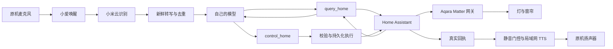

# 小米音箱 → Jarvis

简体中文 · [English](README.md)

**不拆音箱，复用它自带的麦克风和扬声器，让自己的模型通过 Home Assistant 控制家里的灯和窗帘。**

这个仓库把一次完整接入实践整理成 Agent Skill、分阶段详细手册和可运行的 Python 参考实现。内容从局域网找音箱开始，覆盖身份认证、树莓派和 Aqara 网关、语音输入与播报、原生模型工具、常驻运行及实机验收。

已验证路线保留**小爱唤醒和小米云识别**，后续语义理解、设备选择交给自己的模型，动作由 Home Assistant 执行，再用原音箱播报真实结果。

> 这是云转写桥接方案，不是替换固件。没有取得 root，没有读取原始麦克风 PCM，没有改成本地“贾维斯”唤醒，也没有彻底关闭小米内部的理解与执行逻辑。

## 一次正常交互

```text
你：    小爱同学 → 把客厅的灯关掉
小米：  识别语音，提供一条新鲜转写。
模型：  调用 query_home，再用 control_home 选择客厅灯。
Jarvis：校验整批动作，持久化，发送 HA 请求并回读状态。
音箱：  播报实际结果，然后回到待机静音。
```

唤醒后无需再单独说一次“贾维斯”。“客厅的灯”由模型按房间和类别理解，不要求逐字报出 HA 实体名称。“不要关灯”“先给我建议”不应触发真实控制。



当前参考实现每次输入最多一个只读工具回合和一个终止规划的控制批。执行器直接播报真实回执，不让模型再改写“是否成功”，也不自动循环重试设备动作。

## 安装 Skill

克隆仓库，将完整 Skill 文件夹复制到宿主的技能目录。以 Codex 为例：

```bash
git clone https://github.com/WdBlink/xiaomi-speaker-jarvis-skill.git
cd xiaomi-speaker-jarvis-skill
mkdir -p "$HOME/.codex/skills"
test ! -e "$HOME/.codex/skills/xiaomi-speaker-jarvis" && \
  test ! -L "$HOME/.codex/skills/xiaomi-speaker-jarvis" && \
  cp -R skills/xiaomi-speaker-jarvis "$HOME/.codex/skills/xiaomi-speaker-jarvis"
```

目标已存在时先检查，不能直接覆盖。其他 Agent 按其技能安装机制操作，保留 `references`、`assets` 和入口文件。

可以这样提需求：

> 使用 `$xiaomi-speaker-jarvis` 检查我现有的小米音箱和 Home Assistant，从当前进度继续完成免拆机接入，让自己的模型控制真实设备。复用已有配对，凭据留在本地，按实际证据验收。

Skill 与详细手册使用中文；仓库入口提供完整中英文说明。每章包含关键操作、判断依据、成功证据和失败分支。

## 按当前阶段阅读

| 阶段 | 详细手册 | 关键细节 |
| --- | --- | --- |
| 1. 发现与认证 | [局域网和账号](skills/xiaomi-speaker-jarvis/references/01-discovery-and-auth.md) | 型号证据链、miIO token 与 micoapi 会话区别、二维码显示和失效、STS 回调、SSH 的边界 |
| 2. 接入家居 | [HA 与 Matter](skills/xiaomi-speaker-jarvis/references/02-home-assistant-matter.md) | 树莓派、IPv6、M2 配对、保留 HomeKit、镜像拉取失败恢复、房间与回路映射 |
| 3. 接通语音 | [识别与播报](skills/xiaomi-speaker-jarvis/references/03-voice-and-audio.md) | 新鲜度和去重、原机 TTS、暂停语义、miIO 空闲时间戳、正确静音路径 |
| 4. 接入模型 | [原生工具与执行](skills/xiaomi-speaker-jarvis/references/04-agent-tools-and-execution.md) | 房间类别泛化、当前时间与设备事实、持久化动作、取消、真实回执 |
| 5. 常驻验收 | [运维与分层验证](skills/xiaomi-speaker-jarvis/references/05-operations-and-validation.md) | 真实动作、恢复、重启不重放、退出恢复音量 |
| 6. 排查故障 | [故障手册](skills/xiaomi-speaker-jarvis/references/06-troubleshooting.md) | 症状、检查点、失败方案和仍未解决的问题 |
| 7. 运行代码 | [参考实现部署](skills/xiaomi-speaker-jarvis/references/07-reference-runtime.md) | 依赖、精确配置字段、登录、启动和只读探针 |

## 运行参考代码

需要 Python 3.12、绑定自己小米账号的受支持音箱、可访问的 HA、已核对的设备目录和模型账号。原实践在 Mac 上运行语音桥，树莓派上运行 HA。Python 桥可在 Linux 运行；附带的服务模板用于 macOS launchd。当前运行时不支持 Windows。

```bash
cd skills/xiaomi-speaker-jarvis/assets/runtime
python3.12 -m venv .venv
.venv/bin/python -m pip install -e .
.venv/bin/python -m unittest discover -s tests -v
```

测试使用虚构配置和替身传输，不连接你家设备。完成[运行时部署指南](skills/xiaomi-speaker-jarvis/references/07-reference-runtime.md)后再启动真实服务。示例凭据故意不可用；真实凭据、二维码、数据库均放在仓库之外。

随附模型适配器当前只允许官方 MiniMax 地址和配置支持的模型。换用其他提供商需要实现并验证其原生工具协议，不能只随意替换 base URL。架构可以复用，HA 和小米凭据不会交给模型。

## 哪些经过验证

| 组件 | 原实践证据 |
| --- | --- |
| 音箱 | 小米 AI 音箱二代，产品 `MDZ-25-DA`，内部 `xiaomi.wifispeaker.s12`，固件 `1.76.54` |
| 输入 | 原机唤醒、小米云转写；没有原始 PCM |
| 输出 | 局域网旧接口 `tts`、`play_pause`；通过云播放控制的 `media=airplay` 路径调整共享音量 |
| 家居 | 树莓派 HA Container、独立 Matter 服务、Aqara M2 桥 |
| 控制 | 灯和窗帘经 HA 状态回读确认；名称与房间另外映射 |
| 模型 | MiniMax-M3 原生 `query_home`、`control_home` |

原工程最终通过 255 项自动检查，并做过真实局域网、HA、模型和 TTS 验证。公开参考包排除了无关 LiveKit/ASR 组件，另有独立的[发布验收记录](VALIDATION.md)。测试数量不等于实机场景数量。

首次原生工具部署中的两条窗帘语音请求曾失败，旧日志未保留异常原因。后续回放与完整入口正常，不能据此认定原始故障根因已修复。参考代码已增加脱敏模型日志，本仓库不作无人值守稳定性承诺。

## 保留这些边界

- 仍依赖小米云、有效账号会话和非公开稳定接口；唤醒词保持“小爱同学”。
- 待机静音抑制原生声音，不会关闭小米 NLU 或其设备动作。Jarvis 播报时再次唤醒，仍可能有原声重叠。
- TTS `accepted` 只表示设备接收，必须另查起播、结束和现场听音。
- 模型负责理解语义，白名单和参数校验负责限制可执行范围，两者不能互相替代。
- 写入失败或结果不确定时不自动重试。取消不能撤销已发出的物理动作。
- 其他型号、固件和部署环境要重新核验。端口开放、token 有效和 root 权限是不同能力。

## 开发与来源

在仓库根目录运行 `python3 scripts/validate_package.py`，检查可发布目录结构和本地文档链接。GitHub Actions 同时执行参考运行时测试。实际发布前检查结果见 [VALIDATION.md](VALIDATION.md)。

这是独立项目，不属于小米、Aqara、Home Assistant 或 MiniMax 官方产品。[来源与致谢](UPSTREAM.md)列出协议文档与社区项目。文档 IP、ID 和凭据均为虚构示例，不包含原家庭日志或凭据。

本仓库原创内容采用 [MIT License](LICENSE)，依赖保留各自许可证。
